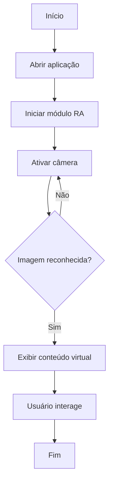

# AR Maintenance Guide

> **Projeto exemplo — UPX: Realidade Aumentada**  
> Repositório-modelo para documentação técnica de projetos desenvolvidos na disciplina.


---

## 1. Identificação do Projeto

| Item           | Informação                                                                                                                                                  |
| -------------- | ----------------------------------------------------------------------------------------------------------------------------------------------------------- |
| **Projeto**    | AGV                                                                                                                                                         |
| **Equipe**     | Jorge Henrique Gobbo Berenschot <br> Kauan Victor Marques <br> Pedro Henrique Santana de Oliveira <br> Gabriel Pelincel Ramalho <br> Felipe Matias de Jesus |
| **Curso**      | Engenharia de Computação                                                                                                                                    |
| **Disciplina** | UPX — Realidade Aumentada                                                                                                                                   |
| **Professor**  | Nome do professor                                                                                                                                           |
| **Semestre**   | 2026.2                                                                                                                                                      |

### Integrantes

| Nome                               | RA     | Responsabilidade                              |
| ---------------------------------- | ------ | --------------------------------------------- |
| Jorge Henrique Gobbo Berenschot    | 235317 | Scrum Master                                  |
| Kauan Victor Marques               | 235003 | Interface, testes, documentação e coordenação |
| Pedro Henrique Santana de Oliveira | 23705  | Documentação                                  |
| Gabriel Pelincel Ramalho           | 222434 | Codificação e organização                     |
| Felipe Matias de Jesus             | 226705 | Documentação                                  |

---

## 2. Visão Geral

O projeto investiga o uso de Realidade Aumentada (RA) na teleoperação de Veículos Guiados Automaticamente (AGVs) para solucionar as limitações dos fluxos de vídeo bidimensionais convencionais durante situações de exceção na intralogística.

A proposta consiste em utilizar um sensor RGB-D, um microcontrolador Arduino e uma interface web para sobrepor informações espaciais espacialmente registradas — como destaque de obstáculos, indicação de distâncias e zonas de segurança — diretamente sobre o vídeo de teleoperação.

Por meio de uma abordagem metodológica mista que avalia desempenho e percepção dos operadores, o estudo visa desenvolver interfaces de navegação remota mais seguras, intuitivas e acessíveis, reduzindo a taxa de colisões e a carga cognitiva em ambientes industriais.

---

## 3. Problema

Em ambientes de intralogística, a operação autônoma de Veículos Guiados Automaticamente (AGVs) pode ser interrompida por situações de exceção, como obstáculos inesperados ou falhas de percepção, exigindo intervenção humana remota. Nesses momentos, o operador assume o controle por meio de um fluxo de vídeo bidimensional tradicional.

Essa interface convencional degrada severamente a percepção de profundidade e a consciência situacional, o que eleva a carga cognitiva, aumenta o tempo de execução da tarefa e favorece o risco de colisões em ambientes industriais compartilhados entre pessoas e robôs.

---

## 4. Objetivos

### 4.1 Objetivo Geral

Desenvolver e avaliar uma interface de teleoperação baseada em Realidade Aumentada que sobreponha ao vídeo de um AGV informações de profundidade e de obstáculos obtidas por sensor RGB-D, investigando seu efeito no desempenho, na carga de trabalho e na usabilidade percebida por operadores em tarefas de navegação remota em cenário de intralogística.

### 4.2 Objetivos Técnicos

- Levantamento e comparação de trabalhos que empregam RA e interfaces espaciais na teleoperação de robôs móveis.

- Identificação dos requisitos das sobreposições, definindo quais informações serão apresentadas e como serão registradas sobre o vídeo a partir do mapa de profundidade.

- Desenvolvimento de uma prova de conceito das sobreposições integrada ao servidor de teleoperação existente.

- Evolução da prova de conceito para um protótipo experimental estável.

- Estabelecimento do procedimento de avaliação, com definição da tarefa, do cenário, das condições comparadas e dos instrumentos.

- Coleta de dados de desempenho (tempo, colisões, intervenções, latência e taxa de quadros) e de percepção (SUS e NASA-TLX) com operadores.

- Análise dos resultados e confronto com as hipóteses de pesquisa.

---

## 5. Público-Alvo

O projeto é direcionado a operadores não especialistas que realizam a condução remota de Veículos Guiados Automaticamente (AGVs) em situações de exceção na intralogística, bem como a pesquisadores, projetistas de sistemas de interação humano-robô e pequenas e médias empresas que buscam alternativas acessíveis para a automação industrial.

Materiais complementares de público-alvo, persona e jornada podem ser armazenados em `docs/documents/`.

---

## 6. Funcionalidades

| ID   | Funcionalidade         | Descrição                                      | Status |
| ---- | ---------------------- | ---------------------------------------------- | ------ |
| RF01 | Iniciar experiência RA | Abre a cena principal de Realidade Aumentada   | ✅     |
| RF02 | Reconhecer imagem      | Identifica uma imagem cadastrada na biblioteca | ✅     |
| RF03 | Exibir objeto 3D       | Instancia conteúdo virtual associado           | ✅     |
| RF04 | Mostrar instrução      | Exibe informação textual relacionada           | 🚧     |
| RF05 | Interagir com objeto   | Permite seleção e manipulação simples          | ⬜     |

**Legenda:** ✅ Implementado · 🚧 Em desenvolvimento · ⬜ Planejado · ❌ Cancelado

---

## 7. Requisitos Não Funcionais

| ID    | Categoria       | Requisito                                                                                    |
| ----- | --------------- | -------------------------------------------------------------------------------------------- |
| RNF01 | Compatibilidade | A aplicação deverá ser testada em pelo menos um dispositivo Android compatível com ARCore    |
| RNF02 | Desempenho      | O conteúdo virtual deverá ser exibido sem travamentos que impeçam o uso                      |
| RNF03 | Usabilidade     | O usuário deverá conseguir iniciar a experiência RA a partir da tela principal               |
| RNF04 | Hardware        | O dispositivo deve possuir câmera e suporte aos recursos RA utilizados                       |
| RNF05 | Documentação    | O repositório deve permitir que outra pessoa compreenda como configurar e executar o projeto |

---

## 8. Tecnologias Utilizadas

> As versões abaixo são **exemplos**. A equipe deve registrar as versões efetivamente utilizadas.

| Tecnologia           | Versão de exemplo    | Utilização                           |
| -------------------- | -------------------- | ------------------------------------ |
| Unity                | 6000.x               | Desenvolvimento principal            |
| C#                   | compatível com Unity | Scripts da aplicação                 |
| AR Foundation        | 6.x                  | Camada de abstração de RA            |
| ARCore XR Plugin     | 6.x                  | Recursos RA em Android               |
| XR Plugin Management | 4.x                  | Gerenciamento de plugins XR          |
| Blender              | 4.x                  | Modelagem/edição 3D                  |
| Git                  | 2.x                  | Controle de versão                   |
| GitHub               | —                    | Hospedagem do projeto e documentação |

---

## 9. Hardware Utilizado

| Equipamento | Modelo    | Característica relevante | Utilização        |
| ----------- | --------- | ------------------------ | ----------------- |
| Smartphone  | Preencher | Android / suporte ARCore | Execução e testes |
| Computador  | Preencher | CPU, RAM, GPU            | Desenvolvimento   |

> Não declare compatibilidade com equipamentos que não tenham sido utilizados ou testados.

---

## 10. Arquitetura do Sistema

A arquitetura de exemplo está organizada em camadas simples: interface, aplicação, módulo de RA, framework XR e hardware do dispositivo.


### Fluxo resumido

```text
Usuário
   ↓
Interface da Aplicação
   ↓
Controle da Experiência
   ↓
AR Foundation
   ↓
ARCore
   ↓
Câmera / Sensores
   ↓
Ambiente Físico
```

---

## 11. Funcionamento da Realidade Aumentada

### 11.1 Técnica utilizada

Neste exemplo é utilizado **Image Tracking**, no qual uma imagem previamente cadastrada funciona como referência para ativar o conteúdo virtual.

### 11.2 Fluxo técnico


1. A aplicação inicia a câmera do dispositivo.
2. O módulo de RA analisa continuamente as imagens capturadas.
3. O sistema compara a imagem observada com a biblioteca de referências.
4. Quando há correspondência, a posição da referência é obtida.
5. O conteúdo virtual é instanciado e associado à posição reconhecida.
6. O usuário visualiza e interage com a informação virtual.

### 11.3 Elementos virtuais

- modelo 3D;
- texto de orientação;
- destaque visual;
- botão de ação;
- indicação de status.

---

## 12. Estrutura do Projeto

```text
upx-ra-repositorio-modelo/
│
├── Assets/
│   ├── Materials/
│   ├── Models/
│   ├── Prefabs/
│   ├── Scenes/
│   ├── Scripts/
│   └── Textures/
│
├── Packages/
├── ProjectSettings/
│
├── docs/
│   ├── diagrams/
│   ├── documents/
│   └── images/
│
├── .gitignore
├── CHANGELOG.md
├── README.md
└── README-PREENCHIMENTO.md
```

### Pastas principais

| Pasta            | Finalidade                     |
| ---------------- | ------------------------------ |
| `Assets/Scripts` | Scripts produzidos pela equipe |
| `Assets/Scenes`  | Cenas da aplicação             |
| `Assets/Models`  | Modelos 3D                     |
| `Assets/Prefabs` | Objetos reutilizáveis          |
| `docs/diagrams`  | Diagramas técnicos             |
| `docs/images`    | Screenshots e figuras          |
| `docs/documents` | Documentos complementares      |

---

## 13. Principais Scripts

| Script                       | Responsabilidade                              |
| ---------------------------- | --------------------------------------------- |
| `ImageTrackingController.cs` | Controla eventos de reconhecimento de imagens |
| `ARContentManager.cs`        | Ativa ou instancia conteúdo virtual           |
| `InteractionController.cs`   | Exemplo de ponto de extensão para interação   |

Os arquivos demonstrativos estão em `Assets/Scripts/`.

---

## 14. Dependências

Exemplo de dependências esperadas:

```text
AR Foundation 6.x
ARCore XR Plugin 6.x
XR Plugin Management 4.x
TextMeshPro 3.x
```

A equipe deverá atualizar esta seção com as versões reais presentes em seu projeto.

---

## 15. Configuração do Ambiente

### Pré-requisitos de exemplo

- Windows 10 ou 11;
- Unity Hub;
- versão do Unity utilizada pela equipe;
- Android Build Support;
- Android SDK/NDK quando necessário;
- Git;
- dispositivo compatível com a tecnologia escolhida.

### Procedimento

1. Instale o Unity Hub.
2. Instale a versão do Unity indicada no README.
3. Inclua os módulos necessários para a plataforma de destino.
4. Instale o Git.
5. Clone o repositório.
6. Abra o projeto pelo Unity Hub.
7. Aguarde a importação das dependências.
8. Verifique as configurações de XR antes da primeira execução.

---

## 16. Como Executar

```bash
git clone https://github.com/USUARIO/REPOSITORIO.git
cd REPOSITORIO
```

Depois:

1. Abra o Unity Hub.
2. Clique em **Add / Open Project**.
3. Selecione a pasta clonada.
4. Confirme a versão correta do Unity.
5. Abra a cena principal do projeto.
6. Verifique a plataforma em **Build Settings / Build Profiles**.
7. Conecte um dispositivo compatível.
8. Execute **Build and Run**.

> A equipe deve adaptar esse passo a passo à tecnologia realmente utilizada.

---

## 17. Como Utilizar a Aplicação

1. Abra a aplicação no dispositivo.
2. Autorize o acesso à câmera.
3. Selecione **Iniciar RA**.
4. Aponte a câmera para a imagem de referência.
5. Aguarde o reconhecimento.
6. Observe o conteúdo virtual exibido.
7. Utilize os controles disponíveis.


---

## 18. Fluxo de Funcionamento



---

## 19. Caso de Uso

O diagrama abaixo representa apenas um exemplo simplificado de interação.


---

## 20. Fluxo de Navegação

```text
Tela Inicial
    ↓
Iniciar RA
    ↓
Câmera
    ↓
Reconhecimento
    ↓
Conteúdo Virtual
    ↓
Interação
```

---

## 21. Interface

Armazene screenshots reais do projeto em `docs/images/`.

Exemplo de organização:

```text
docs/images/
├── tela-inicial.png
├── experiencia-ra.png
└── resultado-teste.png
```

Neste modelo, foi incluída uma figura ilustrativa:


---

## 22. Testes Técnicos

| Teste          | Procedimento          | Resultado esperado | Resultado obtido | Status |
| -------------- | --------------------- | ------------------ | ---------------- | ------ |
| Inicialização  | Abrir aplicativo      | Aplicação inicia   | Exemplo          | ✅     |
| Câmera         | Iniciar módulo RA     | Câmera é ativada   | Exemplo          | ✅     |
| Image Tracking | Apontar referência    | Imagem é detectada | Exemplo          | ✅     |
| Conteúdo 3D    | Reconhecer referência | Objeto é exibido   | Exemplo          | 🚧     |

> Substitua os resultados de exemplo por evidências reais.

---

## 23. Dispositivos Testados

| Dispositivo | Sistema | Versão    | Resultado |
| ----------- | ------- | --------- | --------- |
| Preencher   | Android | Preencher | Preencher |

---

## 24. Limitações Conhecidas

Exemplos de limitações que devem ser registradas quando aplicáveis:

- reconhecimento afetado por iluminação inadequada;
- necessidade de manter a referência visível;
- suporte limitado a determinados dispositivos;
- modelos 3D ainda não otimizados;
- funcionalidades planejadas ainda não implementadas.

---

## 25. Evidências de Funcionamento

A equipe deverá incluir:

- pelo menos uma captura de tela do projeto em execução;
- uma imagem ou vídeo da experiência RA;
- quando possível, um vídeo demonstrativo publicado.

Exemplo:

```markdown
[Assistir demonstração](COLE_AQUI_O_LINK_DO_VIDEO)
```

---

## 26. Repositórios e Recursos

| Recurso                   | Link        |
| ------------------------- | ----------- |
| Código-fonte              | Inserir URL |
| Figma                     | Inserir URL |
| Trello/Jira               | Inserir URL |
| Vídeo                     | Inserir URL |
| Documentação complementar | Inserir URL |

---

## 27. Cronograma Técnico

| Atividade               | Responsável | Status |
| ----------------------- | ----------- | ------ |
| Configuração do projeto | Aluno 1     | ✅     |
| Implementação RA        | Aluno 1     | 🚧     |
| Interface               | Aluno 2     | 🚧     |
| Modelos 3D              | Aluno 3     | 🚧     |
| Testes                  | Equipe      | ⬜     |
| Documentação            | Equipe      | 🚧     |

---

## 28. Controle de Versão

Exemplos de mensagens de commit:

```text
feat: adiciona reconhecimento de imagem
fix: corrige posicionamento do objeto virtual
docs: atualiza instruções de execução
test: registra teste em dispositivo Android
```

A equipe deverá evitar concentrar todo o desenvolvimento em um único commit.

---

## 29. Problemas Encontrados e Soluções

### Problema 1 — Conteúdo virtual não aparece

**Problema:** o objeto virtual não é exibido após o reconhecimento.  
**Causa:** referência ou prefab não associado corretamente.  
**Solução:** revisar a biblioteca de imagens e a associação do conteúdo virtual.

### Problema 2 — Perda de tracking

**Problema:** o conteúdo fica instável em determinadas condições.  
**Causa:** baixa iluminação ou referência pouco distinta.  
**Solução:** melhorar as condições de captura e revisar a imagem de referência.

---

## 30. Melhorias Futuras

- adicionar novos objetos de referência;
- melhorar a interação com conteúdo 3D;
- registrar métricas de utilização;
- ampliar compatibilidade;
- adicionar persistência de dados;
- melhorar a interface.

---

## 31. Custos e Recursos

| Recurso    | Tipo     | Custo/Condição             |
| ---------- | -------- | -------------------------- |
| Unity      | Software | Conforme licença utilizada |
| Blender    | Software | Gratuito                   |
| Smartphone | Hardware | Equipamento da equipe      |
| Computador | Hardware | Equipamento da equipe      |

---

## 32. Licença

Projeto acadêmico desenvolvido para fins educacionais na disciplina de UPX — Realidade Aumentada.

Caso a equipe utilize uma licença formal de software, substitua este texto e inclua o arquivo `LICENSE` correspondente.

---

## 33. Autores

- **Aluno 1** — desenvolvimento RA
- **Aluno 2** — interface e documentação
- **Aluno 3** — modelos 3D

**Instituição:** UniFacens  
**Disciplina:** UPX — Realidade Aumentada  
**Semestre:** 2026.2

---

## Checklist de Entrega

- [ ] Código-fonte atualizado
- [ ] README completamente preenchido
- [ ] Versões das tecnologias registradas
- [ ] Arquitetura apresentada
- [ ] Funcionamento da RA explicado
- [ ] Estrutura de pastas documentada
- [ ] Scripts principais descritos
- [ ] Procedimento de instalação testado
- [ ] Procedimento de execução testado
- [ ] Screenshots reais adicionados
- [ ] Testes registrados
- [ ] Dispositivos testados informados
- [ ] Limitações conhecidas documentadas
- [ ] Evidência de funcionamento adicionada
- [ ] Commits representam a evolução do projeto

---

> **Orientação final:** este repositório é um modelo. O trabalho da equipe deve substituir exemplos genéricos por conteúdo real, técnico, verificável e atualizado.
